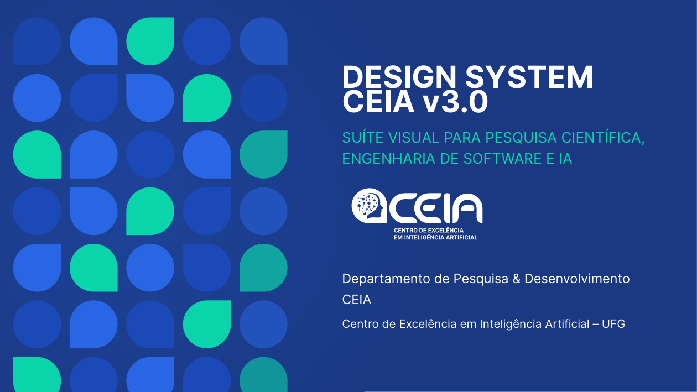
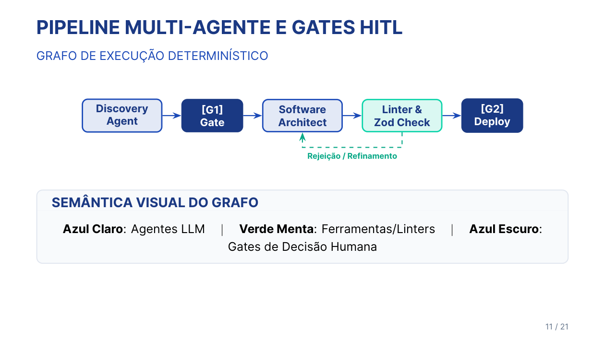
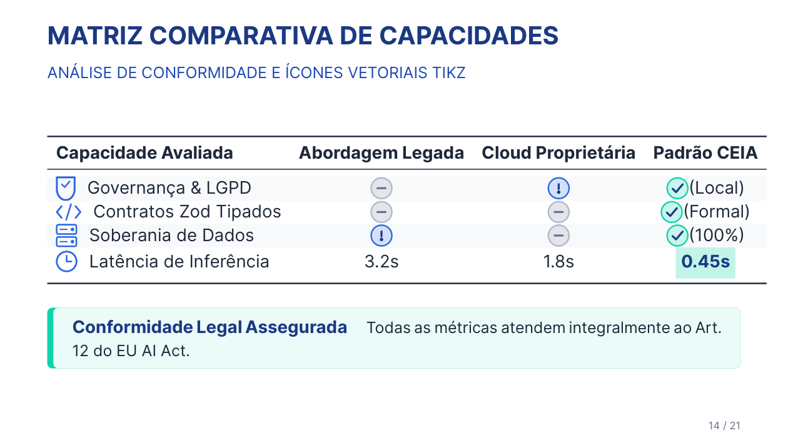
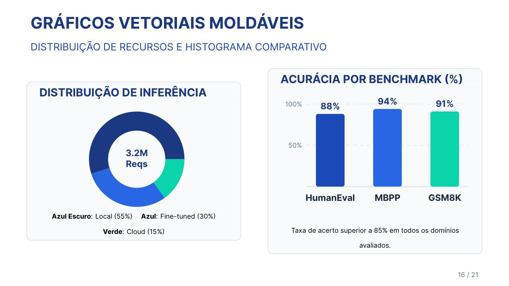
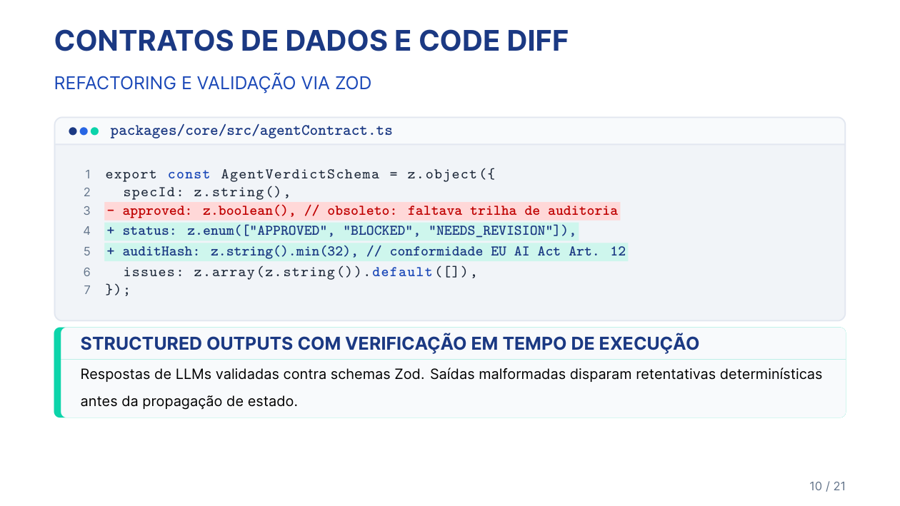
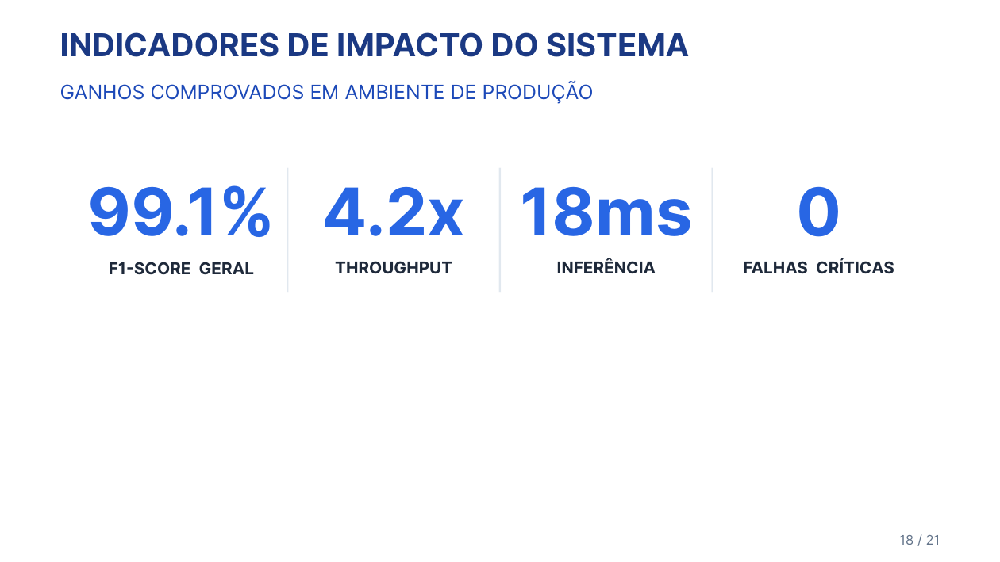

# CEIATeX-Presentation

> **Template Oficial de Apresentações em LaTeX Beamer do CEIA (Centro de Excelência em Inteligência Artificial)**  
> *Desenvolvido para Pesquisa Científica, Engenharia de Software e IA — Totalmente compatível com Overleaf e IDEs modernas.*

[](https://ctan.org/pkg/beamer)
[](https://www.overleaf.com/)
[](https://tectonic-typesetting.github.io/)
[](CEIA_Brand_Guidelines_compressed.pdf)

---

## 🎯 Visão Geral

O **CEIATeX-Presentation** é o sistema visual canônico de apresentações em slides do **CEIA**, projetado para unir o rigor estético do **Manual de Uso da Marca (Goiânia, 2026)** à produtividade técnica de engenharia de software e pesquisa científica.

Ele foi construído do zero com foco em **alta moldabilidade**: tabelas executivas com marcadores vetoriais, diagramas de agentes declarativos sem coordenadas manuais, ícones vetoriais nativos em TikZ puro, linha do tempo/roadmaps, gráficos científicos (donuts, barras verticais e horizontais), layouts de figuras laterais e blocos semânticos.

---

## 📸 Galeria de Demonstração

| Capa Institucional | Multi-Agente & HITL Gates |
| :---: | :---: |
|  |  |
| **Matriz Comparativa & Tabelas** | **Gráficos Científicos Vetoriais** |
|  |  |
| **Code Diff & Janela IDE** | **Métricas e Indicadores de Impacto** |
|  |  |

> 💡 *Todos os 23 slides renderizados em alta definição estão disponíveis na pasta [`figs/`](figs/).*

---

## 🚀 Como Usar no Overleaf (1-Click Setup)

O projeto já vem 100% pré-configurado para o **Overleaf**:

1. Baixe este repositório como arquivo **ZIP** (botão verde `<> Code` $\rightarrow$ `Download ZIP` no GitHub).
2. Acesse sua conta no [Overleaf](https://www.overleaf.com/).
3. Clique em **Novo Projeto** $\rightarrow$ **Fazer Upload de Projeto** e selecione o arquivo ZIP baixado.
4. Clique em **Recompilar**.

> [!NOTE]  
> O arquivo `.latexmkrc` incluso na raiz do projeto força automaticamente o motor **XeLaTeX** no Overleaf (necessário para a fonte OpenType *Inter* e pacote `fontspec`). Você não precisa alterar nenhuma configuração manual! O ponto de entrada padrão é `main.tex` (que carrega `presentation_ceia.tex`).

---

## 💻 Como Usar em IDEs Locais (VS Code, Cursor, TeXstudio, CLI)

### Opção 1: Compilação Ultra-Rápida com Tectonic (Recomendado)
O [Tectonic](https://tectonic-typesetting.github.io/) baixa e gerencia todos os pacotes TeX automaticamente sem necessidade de instalar gigabytes do TeX Live:

```powershell
# Windows PowerShell
.\compile.ps1
```

```bash
# Linux / macOS
chmod +x compile.sh && ./compile.sh
```

Ou diretamente via CLI:
```bash
tectonic presentation_ceia.tex
```

### Opção 2: Compilação com XeLaTeX Tradicional (TeX Live / MacTeX / MiKTeX)
```bash
xelatex -interaction=nonstopmode -synctex=1 presentation_ceia.tex
xelatex -interaction=nonstopmode -synctex=1 presentation_ceia.tex
```

---

## 🎨 Paleta Cromática Institucional (Manual pág. 14)

Todas as cores da identidade visual do CEIA estão disponíveis como macros LaTeX:

| Cor TeX | HEX | RGB | Aplicação Semântica |
|---|---|---|---|
| `CEIADarkBlue` | `#1B3983` | `27, 57, 131` | Fundo de capas, encerramento, seções, títulos nobres, gates HITL |
| `CEIABlue` | `#1C4AB8` | `28, 74, 184` | Títulos primários, acentos estruturais, bordas |
| `CEIABrightBlue` | `#2866E5` | `40, 102, 229` | Numerais de métricas, agentes LLM, badges de status ativo |
| `CEIAGreen` | `#0CD4AA` | `12, 212, 170` | Verde Menta tecnológico: destaques (`\bestmetric`), tools, linters, sucesso |
| `CEIATextDark` | `#1E293B` | `30, 41, 59` | Slate neutro oficial para texto corrido com máxima legibilidade |
| `CEIATextMuted` | `#64748B` | `100, 116, 139` | Eyebrow headers, legendas de figuras e metadados de rodapé |
| `CEIABorder` | `#E2E8F0` | `226, 232, 240` | Bordas sutis de cards e divisórias |
| `CEIABgSoft` | `#F8FAFC` | `248, 250, 252` | Fundo suave de cards modulares e zebra-striping de tabelas |

---

## 🧩 Catálogo de Blocos Modulares e Sintaxe

### 1. Tabelas Executivas & Marcadores Vetoriais (`ceiamatrixtable`, `ceiadatatable`)
Tabelas com zebra-striping institucional, linhas `booktabs` e marcadores vetoriais:
- `\matrixok`: Círculo verde com checkmark institucional.
- `\matrixwarn`: Círculo azul com exclamação.
- `\matrixfail`: Círculo slate com barra de não-conformidade.
- `\bestmetric{valor}`: Pílula verde-menta de destaque.

```latex
\begin{ceiamatrixtable}{l c c c}
    \textbf{Capacidade Avaliada} & \textbf{Legado} & \textbf{Cloud} & \textbf{Padrão CEIA} \\
    \midrule
    \ceiaicon{shield}\hspace{4pt} Governança \& LGPD & \matrixfail & \matrixwarn & \matrixok (Local) \\
    \ceiaicon{server}\hspace{4pt} Soberania de Dados & \matrixwarn & \matrixfail & \matrixok (100\%) \\
    \ceiaicon{clock}\hspace{4pt} Latência & 3.2s & 1.8s & \bestmetric{0.45s} \\
\end{ceiamatrixtable}
```

Para células descritivas com parágrafo e quebra automática de linha:
```latex
\begin{ceiadatatable}{l c p{8.2cm}}
    \textbf{Módulo} & \textbf{Status} & \textbf{Diretriz Operacional do Sistema} \\
    \midrule
    \ceiaicon{brain}\hspace{3pt} Runtime LLM & \bestmetric{ATIVO} & Execução local com modelos quantizados em 4-bit. \\
\end{ceiadatatable}
```

---

### 2. DSL Declarativa de Multi-Agent Pipeline (`\ceiapipelinefour`, `\ceiapipelinethree`)
Desenhe grafos de agentes sem escrever coordenadas TikZ:
```latex
\ceiapipelinefour{Discovery\\Agent}{agent}{[G1] Decision\\Gate}{gate}{Software\\Architect}{agent}{Automated\\Deploy}{tool}
```
*Roles suportados:* `agent` (azul suave), `gate` (marinho HITL), `tool` (verde menta), `db` (slate soft).

---

### 3. Biblioteca Nativa de Ícones Vetoriais TikZ (`\ceiaicon`)
Ícones 100% vetoriais sem fontes externas:
Sintaxe: `\ceiaicon[cor][escala]{nome}`
```latex
\ceiaicon{brain}     % Rede neural / IA
\ceiaicon{shield}    % Segurança / Governança / LGPD
\ceiaicon{database}  % Banco de dados / Armazenamento
\ceiaicon{code}      % Contratos Zod / Sintaxe < / >
\ceiaicon{server}    % Servidor / Soberania
\ceiaicon{user}      % Validador humano / HITL
\ceiaicon{clock}     % Latência / Tempo de resposta
\ceiaicon{lock}      % Criptografia / Trilha imutável
```

---

### 4. Linha do Tempo e Roadmap Modular (`\ceiaroadmapthree`, `\ceiaroadmapfour`)
```latex
\ceiaroadmapthree{FASE 1 (CONCLUÍDO)}{Elicitação \& Contratos}%
                 {FASE 2 (EM ANDAMENTO)}{Orquestração Local}%
                 {FASE 3 (PLANEJADO)}{Auditoria \& Escala}
```

---

### 5. Layout Canônico de Figura Lateral (`ceiasidefigure`)
Figura técnica emoldurada à esquerda e texto/bullets alinhados à direita:
```latex
\begin{ceiasidefigure}{lib/logos/ceia_simbolo.pdf}{Símbolo Oficial CEIA}
    {\small\bfseries\color{CEIADarkBlue} Princípios de Identidade Visual}\par\vspace{0.3em}
    \begin{itemize}
        \item \textbf{Cérebro Conectado}: Sinergia científica e aplicada.
        \item \textbf{Geometria Oficial}: Arcos com raio $R = W/2$ e ângulo reto de $90^\circ$.
    \end{itemize}
\end{ceiasidefigure}
```

---

### 6. Banners Executivos Institucionais (`\ceiabanner`)
Callouts elegantes com borda esquerda colorida e fundo suave:
```latex
\ceiabanner[ok]{Conformidade Legal Assegurada}{Todas as métricas atendem ao Art. 12 do EU AI Act.}
\ceiabanner[warn]{Atenção}{Modelos proprietários externos não devem receber dados sensíveis.}
\ceiabanner[info]{Tese Central}{Arquiteturas baseadas em contratos reduzem depuração em até 70\%.}
```

---

### 7. Gráficos Vetoriais Nativos em TikZ
- **Rosca / Donut**: `\ceiadonutthree{55}{CEIADarkBlue}{30}{CEIABrightBlue}{15}{CEIAGreen}{3.2M\\Reqs}`
- **Barras Verticais**: `\ceiavbarsthree{88}{HumanEval}{94}{MBPP}{91}{GSM8K}`
- **Barras Horizontais**: `\ceiahbar[CEIAGreen]{Claude 3.5 Sonnet}{92.4}{100}{\%}`
- **Curva de Treino**: `\ceiatrainingchart{(0.5, 95) (1.5, 60) ...}{(0.5, 30) (1.5, 75) ...}`

---

### 8. Cards Modulares e Flexíveis (`ceiacards` & `\ceiacarditem`)
Cards com altura sincronizada automática para 2, 3 ou 4 colunas:
```latex
\begin{ceiacards}[3]
    \ceiacarditem[1]{Pesquisa Aplicada}{Algoritmos com publicação de alto impacto.}
    \ceiacarditem[2]{Governança \& Ética}{Trilhas auditáveis e conformidade com LGPD.}
    \ceiacarditem[3]{Engenharia de IA}{Sistemas escaláveis e observabilidade ponta a ponta.}
\end{ceiacards}
```

---

### 9. Janela de IDE e Code Diffs (`\begin{ceiacode}`)
```latex
\begin{frame}[fragile]{CONTRATOS DE DADOS E CODE DIFF}{REFACTORING E VALIDAÇÃO VIA ZOD}
\begin{ceiacode}[language=Java]{packages/core/src/agentContract.ts}
export const AgentVerdictSchema = z.object({
  specId: z.string(),
(*@\ceiaremoved{- approved: z.boolean(), // obsoleto: faltava trilha de auditoria}@*)
(*@\ceiaadded{+ status: z.enum(["APPROVED", "BLOCKED", "NEEDS\_REVISION"]),}@*)
(*@\ceiaadded{+ auditHash: z.string().min(32), // conformidade EU AI Act Art. 12}@*)
  issues: z.array(z.string()).default([]),
});
\end{ceiacode}
\end{frame}
```

---

### 10. Indicadores Numéricos de Impacto (`\ceiastatfour`)
```latex
\ceiastatfour{99.1\%}{F1-Score Geral}{4.2x}{Throughput}{18ms}{Inferência}{0}{Falhas Críticas}
```

---

## 🤖 Uso com Agentes de IA (Skill Integrada)

Este repositório inclui a skill canônica em `.agents/skills/ceia-presentation/SKILL.md`. Assistentes de IA como **Antigravity**, **Cursor** ou **Copilot** carregam automaticamente as diretrizes de diagramação e regras de ouro do tema ao abrir o projeto.

---

## 📁 Estrutura de Arquivos

```text
├── beamerthemeCeia.sty               # Tema Beamer Oficial v3.4
├── presentation_ceia.tex             # Apresentação Canônica de Referência (23 slides)
├── main.tex                          # Ponto de entrada padrão para o Overleaf
├── .latexmkrc                        # Configuração automática de motor XeLaTeX para Overleaf
├── .gitignore                        # Filtro de arquivos intermediários do LaTeX
├── compile.ps1                       # Script de compilação rápida no Windows
├── compile.sh                        # Script de compilação rápida no Linux/macOS
├── CEIA_Brand_Guidelines_compressed.pdf # Manual de Uso da Marca CEIA 2026 (Comprimido)
├── .agents/skills/ceia-presentation/ # Skill oficial para agentes de IA
│   └── SKILL.md
├── figs/                             # Previews dos slides em alta resolução (PNG)
└── lib/                              # Ativos gráficos vetoriais oficiais
    ├── fonts/                        # Fontes OpenType
    ├── layouts/                      # Texturas e fundos oficiais
    └── logos/                        # Logotipos, submarcas e réguas vetoriais
```

---

## 📄 Licença e Créditos

Desenvolvido para o **Centro de Excelência em Inteligência Artificial (CEIA)** — Universidade Federal de Goiás (UFG), MCTI, FAPEG, EMBRAPII.  
Baseado estritamente no Manual de Identidade Visual CEIA (Goiânia, 2026).
